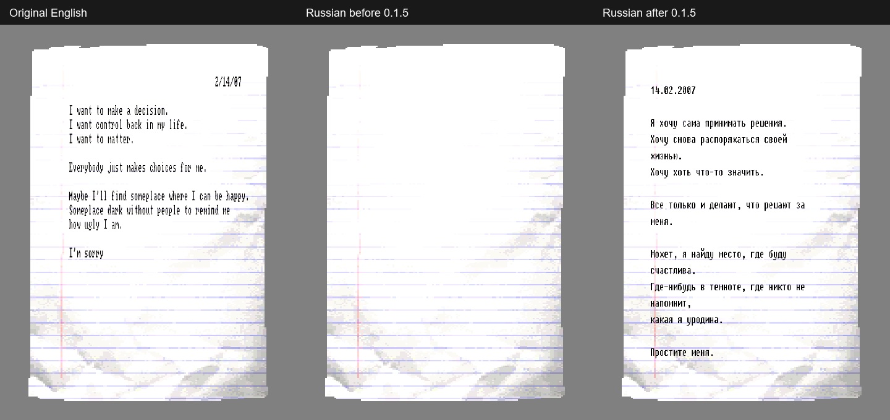

# Проверка всех записок — версия 0.1.5

Проверены исходные данные всех 97 сцен: найдены 41 физический объект записки и 42 TextMesh в 31 сцене. Исправлена подтверждённая ошибка русификатора, из-за которой текст на части лежащих записок исчезал или оказывался вне бумаги.

## Причина и исправление

Unity объединяет статические модели в общий меш сцены. У 26 бумажных объектов MeshFilter.sharedMesh указывает на «Combined Mesh (root: scene)». Прежний WorldNoteLayout использовал его bounds как границы отдельного листа. Это давало неверный масштаб и положение надписи; на некоторых записках она оказывалась далеко от бумаги и даже по другую сторону перекрывающего объекта.

Из исходных ассетов извлечены только индексы соответствующих бумаге firstSubMesh/subMeshCount. Все 41 лист — исходный unit Quad: x/y ±0,5, z=0, четыре вершины и шесть индексов. Для объединённых мешей теперь используются границы этого листа после проверки совпадения индивидуального Renderer.bounds с ожидаемой геометрией. Обычные необъединённые Quad продолжают использовать свои исходные границы. Общий меш сцены и оригинальные файлы игры не меняются.

Дополнительно:

- Сохранены исходно выключенные Renderer записок DARK_PRISON: русификатор больше не создаёт для них видимую надпись. При чтении текст доступен как в оригинале.
- WorldNoteLayout отслеживает изменения исходного TextMesh. Финальная записка SUBWAY_03K / level42 теперь обновляется после Final_school_note_scr.Start и содержит актуальный текст как на бумаге, так и в окне чтения.
- При опустошении текста старая геометрия удаляется. При уничтожении компонента восстанавливается исходное состояние Renderer.

## Где отсутствие надписи предусмотрено оригиналом

- **DARK_PRISON / level94:** BED_NOTE1, BED_NOTE2, BED_NOTE3 и Level/triggers/note1 имеют выключенный Renderer наложенного текста. У первых трёх также выключен Note_pickup_scr.
- **DARK_FOREST2 / level93:** Note_1 (1)/note_text изначально пуст. Текст встроен непосредственно в картинку DLC_page1; пустой TextMesh не означает пропажу записки.
- **Brain_07 / level76:** видимая записка использует text_real. Второй note_text с фразой о неразборчивом тексте изначально неактивен. Чтение и скрытие бумаги используют text_real.
- Декоративные Paper_scrap/Paper_disp без текстовых компонентов и скрипта чтения не содержали наложенных надписей.

## Проверка в движке

Использована отдельная копия Unity 2018.2.21f1 / BepInEx 5 с отдельными company/product. Основная игра не запускалась, её сохранения не использовались. Загружены реальные сцены и материалы бумаги; посторонние игровые скрипты выключены. Для рендера объединённые листы восстановлены как точные исходные Quad по подтверждённой геометрии; плагин размещает текст на исходных объектах сцены.

В проверке чтения выполняются настоящие Start, OnTriggerStay и FixedUpdate Note_pickup_scr с отдельными HUD/Status и управляемым значением Use. Подмена ввода существует только в приватной тестовой DLL. При сравнении заблокированы посторонние автоматические переходы сцен. В установленный русификатор диагностический код не включён.

Результат версии 0.1.5:

| Проверка | Результат |
| --- | --- |
| Учёт всех текстовых компонентов | 42/42 |
| Видимый русский текст на бумаге | 36/36 |
| Открытие, текст чтения и закрытие доступных записок | 38/38 |
| Обновление финальной записки после Start | 1/1 |
| Исходно скрытые/пустые компоненты | 6/6 сохранены |
| Вершины букв в границах листа с отступом 12% | 36/36 |
| Перекрытие надписи непрозрачной стеной | 36/36, утечек пикселей 0 |

Контрольный прогон прежней версии 0.1.4 тем же тестом воспроизвёл полностью невидимый текст на 20 записках, частично видимый на четырёх, выход за границы у 25. Также обнаружены пять случаев прохождения текста перед тестовой стеной из-за неверной глубины расположения, устаревший текст финальной записки и создание лишней геометрии для четырёх скрытых и одного пустого компонента. После исправления — RESULT=PASS, 0 ошибок. Это контролируемая проверка объектов в движке; повторное ручное прохождение всех сюжетных маршрутов не выполнялось.

[Контактный лист всех 36 видимых записок](verification/world-notes-0.1.5-contact.jpg). [Машинный отчёт](WORLD_NOTES_0.1.5.json).

## Установка

Установлены DLL/PDB версии 0.1.5, совпадение проверено по SHA-256. Словарь, шрифты и все 65 пользовательских PNG сохранены побайтно. Две обнаруженные новые пользовательские текстуры names_decal3_spr и office_pos2_D зарегистрированы в манифесте; теперь 65 записей. Удалённые изображения не восстанавливались. Обновление применяется при следующем запуске игры.

Резервная копия прежних DLL/PDB, манифеста и контрольных сумм находится в <LOCAL_CACHE>\world_note_audit_20261024\installed-backup. Приватные исходные данные, скрипт проверки, полные рендеры и отчёты до/после находятся рядом в world_note_audit_20261024 и verification_20261024.

## Полный список компонентов

| Сцена | Объект | Состояние в оригинале |
| --- | --- | --- |
| SUBWAY_01C | `Level/SUB_01_models2/TRAIN_CONTROL/Train (3)/School_Note_1/note_text` | Надпись видна |
| SUBWAY_02 | `School_Note_1/note_text` | Надпись видна |
| SUBWAY_02C | `Level/Level_models/Office_model/Note_2/note_text` | Надпись видна |
| SUBWAY_02C | `Level/Level_models/Office_model/Note_1/note_text` | Надпись видна |
| SUBWAY_02D | `School_Note_1/note_text` | Надпись видна |
| SUBWAY_02F | `School_Note_1/note_text` | Надпись видна |
| SUBWAY_02F | `Note_1/note_text` | Надпись видна |
| SUBWAY_03A | `Level/SUB_01_models2/TRAIN_CONTROL/Train (3)/School_Note_1/note_text` | Надпись видна |
| SUBWAY_03D | `Level/triggers/Note_1/note_text` | Надпись видна |
| 1_Sewers | `Level/triggers/Note_1/note_text` | Надпись видна |
| 1_Sewers | `Level/triggers/Note_2/note_text` | Надпись видна |
| SUBWAY_03E | `School_Note_1/note_text` | Надпись видна |
| SUBWAY_03E | `Note_1/note_text` | Надпись видна |
| SUBWAY_03F | `Note_1/note_text` | Надпись видна |
| SUBWAY_03H | `School_Note_1/note_text` | Надпись видна |
| SUBWAY_03K | `School_Note_1/note_text` | Надпись видна |
| MINE_01 | `mine_note/note_text` | Надпись видна |
| MINE_03 | `mine_note/note_text` | Надпись видна |
| MINE_03 | `mine_note2/note_text` | Надпись видна |
| LAB_02 | `Note_LAB/note_text` | Надпись видна |
| LAB_02C | `Note_LAB/note_text` | Надпись видна |
| LAB_02D | `Note_LAB/note_text` | Надпись видна |
| LAB_02E | `Note_LAB2/note_text` | Надпись видна |
| LAB_02E | `Note_LAB/note_text` | Надпись видна |
| LAB_02F | `Note_LAB/note_text` | Надпись видна |
| LAB_02G | `Note_LAB/note_text` | Надпись видна |
| LAB_02G | `Note_LAB2/note_text` | Надпись видна |
| LAB_02H | `Note_LAB/note_text` | Надпись видна |
| LAB_02B | `Note_LAB/note_text` | Надпись видна |
| LAB_03 | `Level/triggers/Note_LAB/note_text` | Надпись видна |
| LAB_04 | `Note_LAB/note_text` | Надпись видна |
| OFFICE_01 | `Level/triggers/Door_01_blocked/Note_1/note_text` | Надпись видна |
| Brain_02 | `Level/props/Note_BR/note_text` | Надпись видна |
| Brain_03 | `Level/triggers/lab_table_model (2)/Note_BR/note_text` | Надпись видна |
| Brain_04 | `Level/triggers/Note_BR/note_text` | Надпись видна |
| Brain_07 | `Note_1/text_real` | Надпись видна |
| Brain_07 | `Note_1/note_text` | Неактивный запасной текст |
| DARK_FOREST2 | `NEW_LEVEL/TRIGS/Note_1 (1)/note_text` | Исходно пусто; текст в DLC_page1 |
| DARK_PRISON | `Level/Level_models/DLC_Bedroom_model/DLC_dresser_model (2)/top (1)/BED_NOTE1/note_text` | Исходно выключен Renderer |
| DARK_PRISON | `Level/Level_models/DLC_Bedroom_model/DLC_dresser_model/top/BED_NOTE2/note_text` | Исходно выключен Renderer |
| DARK_PRISON | `Level/Level_models/DLC_Bedroom_model/shoebox/DLC_shoebox_model/BED_NOTE3/note_text` | Исходно выключен Renderer |
| DARK_PRISON | `Level/triggers/note1/note_text` | Исходно выключен Renderer |
